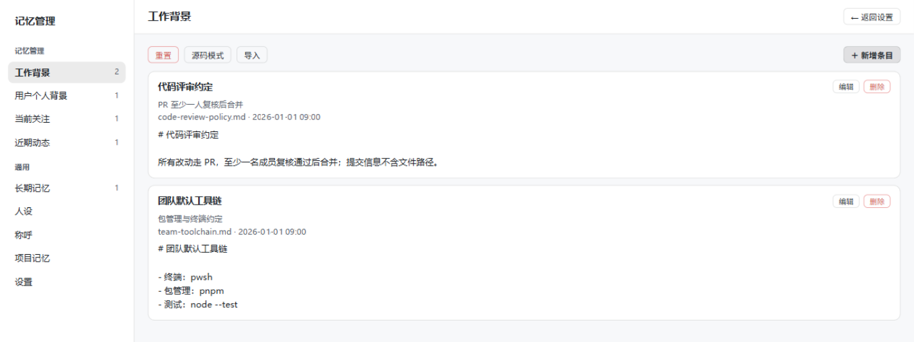
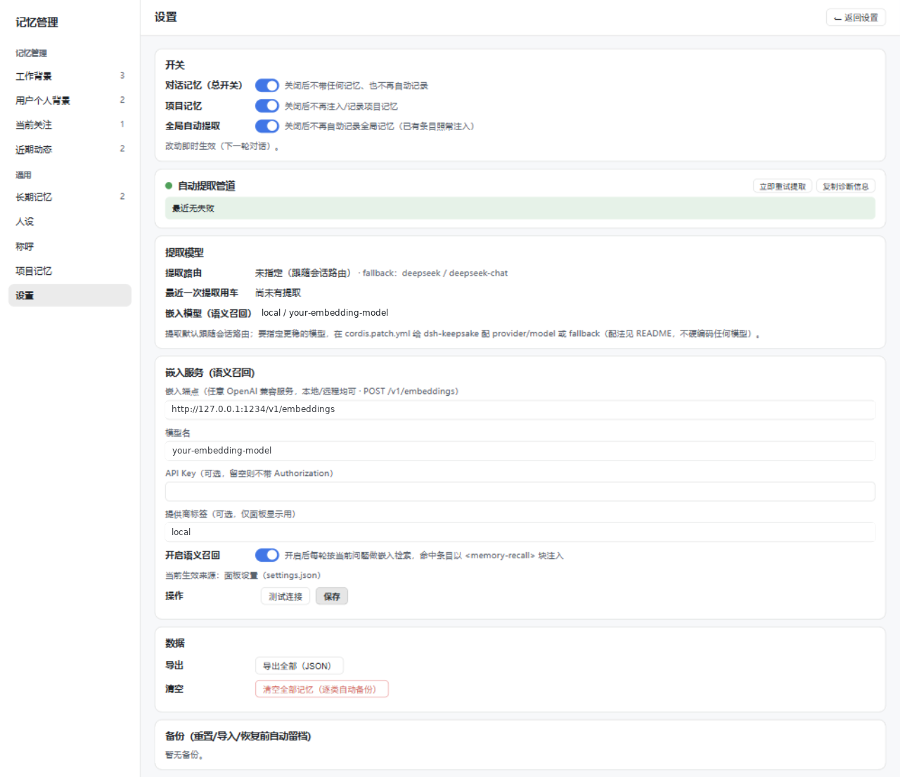

# dsh-keepsake

[](https://github.com/axuan-1314/dsh-keepsake/actions/workflows/ci.yml)
[](https://github.com/axuan-1314/dsh-keepsake/tags)
[](LICENSE)
[](package.json)

> **[English](README.en.md) | 中文**

> DSH（DeepSeek Harness）的跨会话记忆插件：对话里聊过的事自动记下来，下次对话自动带上——你不用每次重复交代背景。附带一个本地「记忆管理」面板，记了什么、删了什么、人设怎么设，全程可见可改。

- **插件版本**：0.5.0（以 `package.json` 为准；变更记录见 [CHANGELOG.md](CHANGELOG.md)）
- **适配宿主**：DSH 0.2.0-rc.2（web / headless / desktop 三个 profile 均可安装）；`package.json` 声明了 DSH peer 范围，安装/启动时宿主会做版本兼容检查，不匹配会让用户显式确认后才装
- **分发**：GitHub 仓库 tag tarball 渠道（+ 本地 clone 作开发）；升级方式见[「升级」](#升级)（DSH 插件不支持自动更新）
- **数据位置**：全部在本地 `~/.dsh/memory/`，不上传任何远端；API 与面板仅本机（loopback）可访问
- **前置条件**：已安装 DSH（web / headless / desktop 任一 profile）；Node ≥ 18；**零运行时依赖**（无需 `npm install`）
- **许可**：MIT License（见 [LICENSE](LICENSE)）

设计参考同类 agent 的项目记忆子系统；v1 采用单次 LLM 调用简化提取。



> 上图为界面示意（使用示例数据渲染）。最快上手（完整步骤见[快速开始](#快速开始)）：

```bash
dsh plugin --profile web add https://github.com/axuan-1314/dsh-keepsake/archive/refs/tags/v0.5.0.tar.gz
```

## 目录

- [这是什么](#这是什么)
- [功能介绍](#功能介绍)
  - [自动记忆：会话结束自动提炼，下次对话自动带上](#自动记忆会话结束自动提炼下次对话自动带上)
  - [内容脱敏：密钥类内容进不了记忆与提示词](#内容脱敏密钥类内容进不了记忆与提示词)
  - [语义召回（可选）](#语义召回可选)
  - [记忆管理面板](#记忆管理面板)
  - [管道健康卡与「立即重试提取」](#管道健康卡与立即重试提取)
  - [提取运行日志与跨重启续提](#提取运行日志与跨重启续提)
  - [提取触发门槛：打分门、空闲延迟与每会话上限](#提取触发门槛打分门空闲延迟与每会话上限)
  - [会话补提：跨重启把失败区间读回来重提](#会话补提跨重启把失败区间读回来重提)
  - [记忆整理：重复、陈旧与索引对账建议](#记忆整理重复陈旧与索引对账建议)
  - [失败韧性：重试、分类、落盘留痕](#失败韧性重试分类落盘留痕)
  - [自动备份](#自动备份)
  - [写入可逆性：快照与回收站](#写入可逆性快照与回收站)
- [快速开始](#快速开始)
  - [安装](#安装)
  - [升级](#升级)
  - [验证生效](#验证生效)
- [配置](#配置)
- [数据与隐私](#数据与隐私)
- [回滚与卸载](#回滚与卸载)
- [FAQ](#faq)
- [工作原理](#工作原理)
- [可观测与运维](#可观测与运维)
- [生态内相关项目](#生态内相关项目)
- [开发与测试](#开发与测试)
- [已知限制](#已知限制)

## 这是什么

DSH 每次新会话都是从零开始：你的工作背景、这个项目的决策历史、上周聊定的口径，全都得重新说一遍。dsh-keepsake 把这件事自动化：

1. **自动提取**——每轮对话结束，插件自动判断这轮有没有值得记的事（用户偏好、项目决策、长期有效的结论……），有就落盘成本地 Markdown 文件；
2. **自动注入**——之后每一轮对话，把已记下的内容以四段形式（人设 / 全局记忆索引 / 项目使用说明 / 项目记忆索引）作为一条插件自有的用户消息注入会话，模型据此"记得"你；
3. **面板管理**——DSH 设置页多一个「记忆」区块，从这里打开记忆管理面板：浏览/编辑/删除/导入导出记忆条目、编辑人设与称呼、开关各路记忆、看提取管道健康状况。

记忆分两层：

- **全局记忆**（跨所有对话生效）：工作背景、用户个人背景、当前关注、近期动态（自动滚动清理，默认保留 30 条 / 30 天）四个对话分类，外加长期记忆；
- **项目记忆**（按工作区路径隔离）：每个项目一个独立目录，记这个项目的决策与状态。

## 功能介绍

以下每条都有源码依据（`lib/` 与 `web/`），按"用户看到什么 / 能得到什么"叙述。

### 自动记忆：会话结束自动提炼，下次对话自动带上

- **无需手动操作**：每一轮对话正常结束（`turn/end` 且 `reason.kind === "completed"`）后自动触发一次提取判断；纯寒暄、命令式短句（不足 3 个词的用户散文）这类没内容可记的轮次自动跳过，不白花 token。
- **增量提取**：插件为每个会话维护提取进度（cursor），只提炼新完成的轮次；提取失败时进度不推进，下一轮自动连本带利重提（自动补提），不会漏记也不会重复记。
- **提取走会话路由**：默认复用你当前对话所用的模型路由（与 session-title 同款捕获策略），不单独配置也能跑；也可以在 `cordis.patch.yml` 显式指定更稳的 `provider` / `model`。
- **跨会话四段注入**：之后每轮对话，插件把记忆作为一条**插件自有的用户消息**注入会话（默认走 durable 消息通道，对所有预设——包括 `complete:true` 的极简预设——都生效，这是 v0.2.0 对旧版"极简模式静默失忆"的根治点；`injectChannel: "section"` 可回退到旧的系统提示词注入）。注入受**双预算**约束：字符口径 `injectMaxChars`（默认 30000）与 token 口径 `injectMaxTokens`（默认 **16000**，CJK 感知估算；0 = 关闭 token 预算、只用字符口径）——超限按优先级整段丢弃，两个上限同时生效。这条消息由四段组成，模型据此"记得"你：

| 注入段 | 模型看到什么 | 预算 |
|---|---|---|
| 人设 | 「用户叫你小助手」「希望你称呼他为朋友」+ 你编辑的补充人设正文 | 400 行 / 16k 字符 |
| 全局记忆索引 | 四分类 + 长期记忆的条目索引；近期动态带年龄与过期倒计时（如「3 天前 · 27 天后过期」） | 每类 22 行（超限保最新），总 120 行 / 12k 字符 |
| 项目使用说明 | 记忆目录在哪、索引怎么读、怎么按你的要求直写/删除记忆 | 固定短文 |
| 项目记忆索引 | 该项目 `MEMORY.md` 索引（每行指向一个记忆文件，模型按需 Read） | 200 行 / 25k 字符，超限保最新丢最旧并附 WARNING |

- **三层开关**（面板「设置」页，改动下一轮对话即生效）：

| 开关 | 关掉后的效果 |
|---|---|
| 对话记忆（总开关） | 四段注入全灭 + 自动提取全停；关掉期间的轮次不积累，重开后不回补 |
| 项目记忆 | 项目使用说明/项目索引不再注入，项目类记忆写入被过滤（计数可见） |
| 全局自动提取 | 不再自动写全局记忆；已有的全局条目照常注入 |

- **防自反馈（按「机器来源」排除）**：注入的记忆消息带 `source.kind = "plugin:dsh-keepsake"` 标记；提取侧按统一的机器来源判据，把**任意插件**（不限本插件）注入的消息、以及 instruction / summary / tool 等系统性消息，都从「用户散文」里排除（既不计入 skip 门槛、也不进提取输入），不会出现"模型把注入的记忆又记回记忆"的自食循环。真人消息（含无来源、steer / followup）永远算数；语义召回的查询文本同样只取真人消息。

### 内容脱敏：密钥类内容进不了记忆与提示词

对话里偶尔会出现密钥、令牌、内网地址这类不该被记下来的内容。脱敏默认开启（`redactionEnabled`，默认 **true**），在两道位置拦截：

- **第一道（进提取提示词之前）**：会话摘录渲染时（用户消息 / 助手回复 / 工具调用 / 工具结果四处）先脱敏再截断——顺序刻意为先脱敏后截断，防止截断把密钥切成两半导致漏检。模型看到与提取用的摘录都是脱敏后的文本；
- **第二道（落盘之前）**：提取产出的写入/删除操作在写记忆文件前再过一道脱敏（纵深防御），只处理条目正文的字符串内容字段，不动文件名、路径、条目标识与操作类型。命中数计入提取运行日志的 `redacted` 字段（有命中才写），面板「最近提取记录」可查。

内置 **7 类固定模式**（清单固定、不做用户自定义正则——防正则回溯拖垮宿主进程）：

1. 私钥块：`-----BEGIN ... PRIVATE KEY-----` 到 `-----END ... PRIVATE KEY-----` 整块；
2. Authorization / Proxy-Authorization 头里的 Bearer / Basic / Token 凭据；
3. 独立出现的 Bearer / Basic 令牌（16 字符以上）；
4. 常见厂商密钥形态：`sk-` 前缀、GitHub PAT（`ghp_` / `gho_` / `ghu_` / `ghs_` / `ghr_` / `github_pat_`）、AWS Access Key（`AKIA`）、Slack 令牌（`xox`）、Google API Key（`AIza`）、JWT（`eyJ` 三段式）；
5. URL 内嵌凭据：`协议://用户:密码@主机` 保留协议与主机、凭据部分换占位符；
6. 敏感键值赋值：`password` / `secret` / `token` / `api_key` / `private_key` / `credentials` 等键名后跟 `:` 或 `=` 的值；
7. 内网 IPv4 地址：`10.x.x.x` / `172.16-31.x.x` / `192.168.x.x`。

命中的内容替换为占位符 `[redacted]`；对已脱敏文本重复执行不再变化（幂等）。不想用时可配 `redactionEnabled: false` 完全关闭，回到不脱敏的旧行为。局限见[「已知限制」](#已知限制)。

### 语义召回（可选）

默认关闭。开启 `recallEnabled` 并配好嵌入端点（`embeddingBaseUrl` / `embeddingModel`）后，每轮对话会按你**当前的问题**语义检索最相关的记忆条目（嵌入余弦 top-k），以 `<memory-recall>` 块注入——不必等模型按索引主动 Read。条目向量按内容增量缓存，只有新写/改动过的条目才重新嵌入。

- **默认关**：不配置端点就不产生任何外部调用（记忆文本不出本机）；指向本地端点（如 `http://127.0.0.1:1234/v1/embeddings`）则记忆文本也不出本机。
- **面板里配置**：设置页「嵌入服务」卡直接填端点 / 模型 / API Key，带「测试连接」按钮；保存后**下一轮对话即生效，不必改 `cordis.patch.yml`、不必重启**（面板配置存于 `~/.dsh/memory/settings.json`，优先于 entry config）。
- **测试连接不转发已存密钥**：已保存的 API Key 只发往它自己配置的那个端点；若「测试连接」的请求指向别的地址，不会把已存密钥带过去（只有请求体里当场填的 Key 才随该地址发送）。
- **密钥不会被重存顶掉**：保存嵌入配置时，Key 输入框留空 = **保留已存密钥**（只改端点/模型等其余字段时无需重输）；「清除已存 Key」按钮（仅已设 Key 时出现）= 显式清空；输入新 Key = 覆盖。
- **自带模型（provider-agnostic）**：插件不绑定任何嵌入模型或厂商——只要你的服务提供 OpenAI 兼容的嵌入端点（绝大多数本地部署都提供），填上 `embeddingBaseUrl` + `embeddingModel` 即可，本地自选模型（EmbeddingGemma、bge-m3 等）同样适用。`embeddingProvider` 只是显示标签，配不配都行。
- **失败显式降级**：端点超时/报错时本轮不召回（不阻塞、不臆造），计数进 `/state.recall`。

### 记忆管理面板

入口：DSH 设置页的记忆区块（下称门牌）→「打开记忆管理」。打开方式自动三级降级（新窗口 → 内嵌 iframe → 整页跳转），面板主题自动跟随宿主深浅色。门牌本身也是快捷操作区（速操台）：总开关、「DSH 的名字」「对我的称呼」两个输入框（防抖自动保存）、状态摘要（全局 N 条 · M 个项目）、提取失败红条 + 「详情」深链。



> 上图为设置页示意（使用示例数据渲染）。记忆管理面板的条目管理见文首截图。

面板（`/dsh-keepsake/panel/`，仅本机可访问）包含：

- **四个对话分类页 + 长期记忆页**：条目卡片流（标题 / 描述 / 文件名 / 更新时间 / 正文），支持——
  - **浏览与检索**：每个分类页与长期记忆页都有即时检索（标题 / 描述 / 正文即时过滤，每页 50 条分页）；近期动态条目带年龄徽标；
  - **编辑**：标题（60 字）、描述（60 字）、正文（20000 字符上限），实时字符与 UTF-8 字节计数；
  - **删除**（确认弹窗）、**新增条目**；
  - **源码模式**：整类序列化成一个文本直接编辑，保存 = 先自动备份再整类重建；
  - **重置**：清空整类（先自动备份）；
  - **导入**：支持上传 `.json` / `.md` 文件（≤2MB）或直接粘贴，三种格式（JSON 结构化逐条 / Markdown 按 `##` 拆条 / Markdown 整段）；先预览将要写入的条目（与现有内容冲突或批内改名的标红），确认后才落盘（落盘前自动备份）；批内同名自动 `-2` / `-3` 避让。
- **人设页**：左右分栏（markdown 编辑 + 实时预览），内置简洁 / 专业 / 幽默 / 伙伴 / 自定义五个预设模板，一键套用；「恢复默认」回到出厂模板（先自动备份）；上限 100KB。人设是官方系统提示的**补充**而非替换，对所有回复生效。
- **称呼页**：「DSH 的名字」「对我的称呼」两个输入框（各 40 字上限），防抖自动保存，与门牌输入框是同一份数据。
- **项目记忆页**（只读概览）：按工作区列出各项目的条目数与最后更新时间；可单项目导出 JSON。项目记忆由对话自动维护，不提供手工编辑。
- **回收站页 / 快照页**（见[「写入可逆性」](#写入可逆性快照与回收站)）：被删条目与批前留档的旧文，可按条或按单个文件恢复。
- **设置页**：三层开关；管道健康卡（含「补提」区，见[「会话补提」](#会话补提跨重启把失败区间读回来重提)）与提取模型卡（见下节）；**记忆整理**卡（见[「记忆整理」](#记忆整理重复陈旧与索引对账建议)）；**保留策略**（回收站保留天数 / 快照保留份数 / 近期动态保留天数三个输入，下一轮对话生效）；数据卡（**导出全部** JSON / **清空全部记忆**——逐类自动备份，人设与称呼保留）；备份列表（最近 20 份，逐份可「恢复此备份」，恢复前还会先备份当前状态）。
  - **损坏可见**：`settings.json` / `addressing.json` / `persona.md` 解析失败时，门牌与面板显示红条「解析失败（已按缺省运行）」，点任意开关 / 重新保存对应内容即可重写修复；损坏档在覆盖写前自动备份 `*.corrupt-<ts>`，原数据不失访。`settings.json` 损坏时除了保留原档（改名 `settings.json.corrupt-<ts>`），还会从影子档 `settings.last-good.json`（每次成功写入同步刷新）恢复用户的开关，恢复不了才落默认——不是简单丢弃重写。设置值不合法被纠正落默认时，设置页会出黄条「N 项设置值不合法已回默认」并列出字段名（`/state.settingsDiagnostics.coercedFields`），重存设置可修正。

### 管道健康卡与「立即重试提取」

设置页的「自动提取管道」健康卡让你一眼看出记忆提取是否健康：

- **三态灯**：绿 = 最近无失败（折叠为一行摘要）；黄 = 近期有过失败但已自动恢复；红 = 当前连续失败（同因连击数）；灰闪 = 正在提取。连击 > 0 期间每 5 秒自动轮询刷新，侧栏「设置」项同步显示红色连击徽标。
- **失败分桶计数**：按原因（无路由 / 无 cwd / LLM 调用 / 解析 / 落盘 IO）分桶，只显示非零桶。
- **最近 5 条失败详情**：时间 / 原因 / 模型 / 错误摘要，配合失败日志路径（`<storageRoot>/extraction-errors.log`）排障。
- **错过区间提示**：「第 X 轮对话之后的内容尚未记录，恢复后自动补提」——告诉你哪些对话可能漏记了；配套「补提」区可逐条重跑（见[「会话补提」](#会话补提跨重启把失败区间读回来重提)）。
- **「立即重试提取」按钮**：对仍有未提取区间的会话真的发起一次 LLM 提取（有确认弹窗，明示消耗少量 token）；点击后按钮进入 busy 态，面板每 2 秒轮询状态最多 60 秒，恢复即提示「提取已恢复」。10 秒最小间隔，提取在途时返回 409。
- **注入预算占用**：健康卡的注入摘要显示 token 口径占用「最近 ≈X tokens / 上限 Y」（`injectMaxTokens` 为 0 时不显 token 段、退回字符展示）；数据源是 `/state.injection` 的 `lastTokens` / `totalTokens`。
- **「复制诊断信息」按钮**：一键复制当前状态摘要，可直接粘贴到 issue。
- **提取模型卡**：如实展示提取路由（显式配置的 `provider`/`model`，或「未指定（跟随会话路由）」）、fallback 换道配置、最近一次提取用车（路由 + 相对时间）、嵌入模型（语义召回所用；未配置时显示为未启用）。

### 提取运行日志与跨重启续提

此前"聊了几轮、记忆里看不出任何反馈"的根因是：成功 / 零产出 / 跳过都不留痕，失败详情只活在进程内存（DSH 一重启归零），失败区间跨重启就永久丢失。本版补上持久观测面：

- **提取运行日志（durable 观测面）**：每次提取结算向 `<storageRoot>/extraction-journal.jsonl` 追加一行——`written`（写 / 删了几条）/ `zero-ops`（模型无可记、或有 op 无可落盘）/ `skipped`（直写记忆、无有效用户发言、总开关关、格式只读）/ `failed`（与失败分桶同名的病因）/ `abandoned`（同一结构性病因连续失败过多，显式放弃该区间、游标已推进不再重试）。追加串行化防并发写坏，行数超 2000 自动轮转留尾 1000；写日志失败只告警、不阻断提取。它不是记忆真源，删除不损失任何记忆（代价是丢掉观测历史与续提边界），见 [FORMAT.md](FORMAT.md) 第七节。
- **面板「最近提取记录」**：设置页健康卡新增折叠清单（时间 + seq 范围 + 结果标签），每轮"为什么没记"有据可查。"未恢复区间"红条改双源——重启后回落盘侧未恢复清单，不再隐身；结构性失败被显式放弃的区间也会在盘上留痕（面板「已放弃 N 段」提示）。
- **跨重启续提**：每会话提取覆盖边界（cursor）随运行日志持久化，DSH 重启后重开旧会话**从上次边界续提**，失败区间不再因重启永久丢失。**取舍**：从没提取过的会话仍不回扫历史——插件的提取由"会话继续产生新轮次"驱动，对一段从未提取过的历史不会主动回补，需该会话继续对话才会接着提。

### 提取触发门槛：打分门、空闲延迟与每会话上限

提取要消耗 token，触发侧有三道成本闸门（全部默认开启，各有独立回滚开关）：

- **打分门**（`extractGateEnabled`，默认开；阈值 `extractGateMinScore`，默认 **6**）：提取前对这批轮次打分——`分数 = 用户词数 + 2×工具种类数 + 2×真人轮次数`，分数低于阈值就不调模型、直接记 `skipped/thin-evidence`（运行日志留痕、进度照常推进）。用户词数沿用既有散文口径（空格词数 + 中文按每 2 字折 1 词）；带工具调用或多轮真人发言的会话轻松过门，纯寒暄薄轮不再白花一次 LLM 调用。
- **空闲延迟**（`extractIdleDelayMs`，默认 **3000** 毫秒；0 = 立即提取）：一轮结束后不立刻起跑，等 3 秒空闲再跑——期间新完成的轮次合并进同一批，突发连续对话只触发一次提取。定时是固定时刻而非滑动窗口，持续对话中也会到期；会话关闭/插件退出时挂起中的提取**立即收口执行**（进既有有界 drain），不丢最后一轮。
- **每会话上限**（`extractMaxRunsPerSession`，默认 **50**；0 = 不限）：单个会话的自动提取次数到顶后，后续触发记 `skipped/session-cap` 并推进进度，不再调模型——病态循环轮（模型反复空转）不会无限烧钱。只约束自动链路，面板手动补提不受限。

### 会话补提：跨重启把失败区间读回来重提

v0.4.1 让失败区间跨重启**看得见**（运行日志持久留痕），v0.4.2 把它推进到**补得上**：

- **面板「补提」区**：设置页健康卡内嵌补提清单，列出未恢复 / 已放弃的提取区间（时间 + seq 范围 + 结果标签），逐条可点「补提」重跑；清单来自提取运行日志，跨重启可见。
- **自动收口**（`autoRecoverEnabled`，默认开）：除手动按钮外，插件还会在三个时机自动补提失败区间——① 会话关闭时（`session/disposed`，只补该会话）；② 每轮对话完成后（`turn/end`，全局清扫）；③ 插件装载后数秒（启动清扫，跨重启续提闭环）。规则：
  - 只自动补**未恢复的失败区间**（kind=failed）；已显式放弃的区间（kind=abandoned）绝不自动重试——"放弃"就是放弃；
  - 同一区间两次自动补提之间有冷却间隔（`autoRecoverCooldownMs`，默认 **300000** 毫秒 = 5 分钟），防止宿主读不回的区间被每个触发面反复白读；
  - 自动补提与手动按钮共用同一把单飞锁（同一时刻只有一次补提），手动与自动天然互斥、绝不并发双跑；
  - 宿主未提供会话持久化服务时自动补提静默不跑（能力缺失不是故障；手动按钮此时如实返回 503）。
- **前提与如实降级**：补提要能读回会话内容，依赖宿主提供会话持久化服务（本机宿主 0.2.0-rc.2 起内置）；旧版宿主没有该服务时，面板如实提示"本机补不了"，接口返回 503（`E_HOST_UNSUPPORTED`）——不假装补过。
- **范围纪律**：补提区间必须**整体落在会话可读范围内**；超出可读范围（含超大会话读回截断后的尾部）的区间显式拒绝、继续留在清单里，绝不把没读到的部分按已补提记账、静默丢记忆。
- **异步与观测**：`POST /api/sessions/recover` 即回 202、后台执行（同一时刻只有一次补提，在途再点返回 409），结果经 `/state.recover`（`inFlight` / `lastAt` / `lastOutcome` / `lastSessionId` / `autoEnabled` / `autoAttempts` / `lastAutoAt` / `lastAutoTrigger`）观测；清单数据面是 `GET /api/sessions/pending`。

### 记忆整理：重复、陈旧与索引对账建议

设置页新增「记忆整理」卡，只出建议、不自动改动你的记忆：

- **重复建议**：正文高度重叠、跨分类同名、标题相近且正文重叠的条目对，附相似度与判断依据——只提示，留哪条由你决定，不自动合并。
- **久未更新提醒**：默认 90 天未更新的条目列表；修改时间缺失的条目如实标「年龄不可知」，不拿 0 天冒充。
- **索引健康与「修复索引」**：把 `MEMORY.md` 索引与磁盘对账（悬挂行 = 索引指向已不存在的文件、漏登记 = 磁盘有条目但索引没这行、空分类），一键修复只增删索引行、**绝不删条目文件**；改动前先把索引原文存进快照（可在「快照」页找回），留档失败即拒绝本次修复。
- **端点**：`GET /api/maintenance/suggestions`（建议清单）、`POST /api/maintenance/repair-index`（响应 `fixed` 为已应用动作明细数组、`fixedCount`、`unchanged`）。

### 失败韧性：重试、分类、落盘留痕

提取是后台静默发生的，所以失败处理必须显式可见：

- **可取消退避重试**：单次提取最多 3 次 attempt（含首次），指数退避 500ms 起步、2s 封顶（jitter ±20%）；上游带 `Retry-After` 时优先采用（钳制防恶意长等）。插件卸载/进程退出时退避立即中断，不白等。
- **失败分类**：按内核 `failure.code` 判可重试（EMPTY_RESPONSE / RATE_LIMIT / SERVER / TIMEOUT / TRANSPORT）；AUTH / INVALID_REQUEST / QUOTA 这类确定性失败立即摊牌，不浪费 attempt。
- **换道兜底**（v0.2.0）：主道 attempt 链不可恢复失败后，按 `fallback` 配置逐条换道（换道同样走完整 attempt 链）；换道成功计入 `/state` 的 `fallbackUsed` 并把最近用车指向该道。未配置 `fallback` 时行为与纯重试完全一致。
- **失败落盘日志**：每次提取失败追加 `<storageRoot>/extraction-errors.log`——常开，不依赖任何环境变量；只记摘要（时间 / pid / 原因 / 路由 / 错误摘要），**不含会话内容**；超过 512KB 轮转两档。
- **结构性失败显式放弃**：无路由 / 无 cwd 这类重试不可能自愈的失败，连续 5 次后显式放弃该区间并记 error 日志，不无限积压。
- **单条容错**：模型输出里个别畸形操作跳单处理（好条目照常落盘）；单条 IO 失败隔离上报，不阻断整批。

### 自动备份

所有批量破坏性操作都有后悔药：

- **自动全量备份**：重置分类 / 确认导入 / 恢复备份 / 重置人设 / 清空全部之前，自动把当前全局记忆（`global/`，含人设与称呼）+ `settings.json` + 项目记忆（`projects/`）全量备份到 `<storageRoot>/backups/<时间戳>/`；
- **滚动保留最新 20 份**，防无界累积；
- **半备份可见且拒恢复**：备份采用两段式落盘（先 `complete: false`，拷完改 `true`），中断的半备份在面板标「不完整」且拒绝恢复；
- **恢复也有后悔药**：恢复备份前先把当前状态再备份一份（`pre-restore`），恢复中途失败时响应会带上这份备份 id 指路自救。

### 写入可逆性：快照与回收站

自动提取的写入不是一锤子买卖——项目侧与全局侧各自留了后路，面板里可查可回滚：

- **批前快照（项目侧）**：一批里要覆写或删除的旧文，落盘前先留档到 `backups/surgical/<batchId>/`（按 `surgicalKeep` 保留最新 30 份）。面板「快照」页可**整份恢复**或**只恢复某个文件**，恢复后自动对账 `MEMORY.md` 索引。
- **回收站（延迟删除）**：删除不再硬删，而是先进 `trash/<entryId>/` 落副本、确认副本落稳后再删原件，按 `trashKeepDays` 默认保留 30 天。面板「回收站」页可单条恢复、单文件恢复，也可清除单条 / 按保留天数清理 / 全清（清空＝真正删除）。此路同时覆盖**自动提取**产生的删除与**面板手动「删除条目」（`DELETE /entry`）**；而**分类重置（`clearCategory`）** 与 **近期动态滚动清理（`pruneRecentActivity`）** 仍是直接删除、不进回收站（分类重置前另有整类自动备份）。
- **写后读校验（项目侧 + 全局侧）**：落盘后回读校验 frontmatter 四字段与正文；校验失败**回滚旧文**（纯新增无旧文可回滚时移除脏档、进回收站），项目侧并留标本于快照 `failed/`。全局侧写路径同样回读校验。
- **硬事实守护（项目侧）**：覆写把既有硬事实（数字、版本号、十六进制标识、字节尺寸）弄丢时留痕告警并计 `hardfactDrops`；`hardfactPolicy` 设为 `block` 则回滚该 op 并计 `hardfactBlocks`（与写后校验失败 `verifyFailed` 分列，不混计；默认 `warn`：只告警不阻断）。判据局限如实说明：检出口径是「同类型硬事实在新文里一个都不剩」或「被极近的值顶掉（疑似誊写错误，如 269 记成 267）」——frontmatter、索引行与日期 / 倒计时等动态注记不参与比对，而**正文里同类数字很多时，整行删除也可能检不出**；warn / block 的策略语义不变。
- **写路径三道闸（项目侧）**：覆写（整段替换）只在带对期望 sha1 时才发生——覆盖 op 的 `sha1` 字段与当前文件不符即拒绝该 op（并计计数器 `expectedSha1Mismatches`），防基于过期内容误覆写；不带 sha1 的「盲写」不会覆盖旧正文，而是**降级为追加**（保留旧正文，新内容接在分隔线后）而不是整段覆盖；提取落盘抢批锁（`<storageRoot>/extract.lock`），锁冲突时阻断破坏性操作。
- **覆盖前自动快照（全局侧）**：自动提取改写全局记忆既有条目前，先把旧文留档到 `backups/surgical/`；快照失败则跳过这次覆盖、原文保持不动（宁可漏一次更新，不可丢旧文）。**面板手动保存（改条目）同样先留档**：留档失败直接拒绝保存（503，旧文一字未动），成功响应带 `preSaveSnapshotId`，可在「快照」页找回被顶掉的旧文。
- **恢复前也留档**：从快照 / 回收站 / 整份备份恢复前，先对恢复目标处已存在的冲突文件留快照。**整份备份恢复**（`restoreBackup`）走「旧档改名 `retired-*` → 换入」流程，换入失败会把旧档改名回原位（**自动回滚**；回滚也失败则保留 `retired-*` 目录供手工恢复）。而**快照 / 回收站恢复**（`restoreSurgicalSnapshot` / `restoreTrash`）**不自动回滚**——它们按条循环写文件，中途失败就地停下、不改回原状；但恢复前的留底快照仍在盘上，API 的失败响应会带上 `preRestoreSnapshotId` 与提示，指向它供你**手工**找回被覆盖的旧版。恢复端点与提取落盘共用同一把批锁，不会边恢复边写入。
- **健康卡可见**：设置页「自动提取管道」健康卡多一行安全面摘要（回收站条数 / 写后校验失败 / 硬事实拦截 / 硬事实丢失告警 / 盲写降级追加 / sha1 不符拒写 / 批锁冲突 / 快照失败——非零才显示）；侧栏也会显示回收站与快照条数。其数据源 `/state.safety` 共十个字段：盘上三项（`surgicalBackups` / `lastSnapshotAt` / `trashPending`）每次请求实时现算，进程内七项计数（`verifyFailed` / `hardfactDrops` / `hardfactBlocks` / `expectedSha1Mismatches` / `blindWriteDowngrades` / `lockConflicts` / `snapshotFailures`）重启清零。

> 真源只有 `*.md` 与 `MEMORY.md`：`backups/` 与 `trash/` 是**可安全删除的副本目录**（删掉不损失当前记忆，只失去回滚能力）。见 [FORMAT.md](FORMAT.md) 第七节。

三项安全面设置写在 `~/.dsh/memory/settings.json`（与三层开关同一份文件，**不是** entry config——写进 `cordis.patch.yml` 会被拒）。其中 `surgicalKeep` / `trashKeepDays` 与近期动态保留天数 `recentKeepDays` 可在设置页「保留策略」卡直接改（下一轮对话生效）；`hardfactPolicy` 当前版本面板暂无输入，需手工改文件、下一轮生效：

| 设置 | 默认 | 说明 |
|---|---|---|
| `surgicalKeep` | 30 | 批前快照保留份数；超过的最旧快照由写入路径自动清理 |
| `trashKeepDays` | 30 | 回收站条目保留天数；过期的由写入路径与面板「清理过期」清掉 |
| `hardfactPolicy` | `warn` | 硬事实丢失策略：`warn`=只告警落日志；`block`=回滚并计 `hardfactBlocks` |

手改取值规则（面板走 `PUT /settings` 同语义）：未提及的键保留现值；`surgicalKeep` / `trashKeepDays` 显式给了非法值（非正整数 / 负数 / 非数值）时按默认值生效；`hardfactPolicy` 给白名单外的值时保留现值（手工写坏文件被读到时回 `warn`）。


## 快速开始

### 安装

两种渠道任选（**零运行时依赖**，全程无需 `npm install`）：

**① GitHub tag tarball（推荐）** —— 从仓库 tag 直接安装，钉死版本：

```bash
dsh plugin --profile web add https://github.com/axuan-1314/dsh-keepsake/archive/refs/tags/v0.5.0.tar.gz
# profile 可选 web / headless / desktop
```

**② 本地克隆（开发 / 自用）** —— 源码改动即时生效，适合改代码：

```bash
dsh plugin --profile web add <克隆到本地的仓库路径>   # 或 git URL
```

装完验证 entry 入树：`dsh --profile web --dump-config`。

安装即启用：`cordis.patch.yml` 显式 `enabled: true`（代码缺省关，fail-closed），开关状态在 YAML 里可见。

> 改代码 / 换版本后要跑新代码：**web profile 由 HMR 自动重载；desktop / headless 需重启对应实例**（桌面端重启应用；headless 每次启动天然取最新）。本地克隆渠道是 `link:` 软链，源码改动无需重新安装。

### 升级

DSH 的插件管理器**不支持自动更新**（官方文案：升级 = 先卸载再装新版）。所以升级 = 用新版本重跑一次安装命令：

```bash
# tag tarball 渠道：升级 = 用目标版本号重跑一次（版本号见 Releases 或 CHANGELOG.md）
dsh plugin --profile web add https://github.com/axuan-1314/dsh-keepsake/archive/refs/tags/<新版本号>.tar.gz
# 本地克隆渠道：git pull 后无需重装（软链生效）
```

- **数据不受升级影响**：记忆、开关、人设、备份全部落在 `~/.dsh/memory/`——**在插件包目录之外**，卸载 / 重装都不碰它（除非你手动删除该目录）。数据与代码分离是刻意设计。
- **升级后需重启**：替换已安装的包后，进程要重启才会加载新 JS 模块（web profile HMR 可自动重载；desktop 重启应用；headless 下次启动）。
- **降级前先备份**：数据目录里的 `keepsake-format.json` 记录存储格式版本（见 [FORMAT.md](FORMAT.md)）。存储格式版本自 v0.3.0 起未再变化（`FORMAT_VERSION=1`），所以从 v0.4.0 退回 v0.2.x 时格式闸**不会**触发——旧版可以正常读写同一份数据；但旧版没有 v0.4.0 的写入安全面（批前快照 / 回收站 / `sha1` 覆盖闸 / 写后读校验），其自动提取的覆写是直接替换。降级前建议先做一次全量备份（设置页数据卡「导出全部」，或直接拷走 `~/.dsh/memory/`）。只读闸本身仍然保留：数据由**更新版本格式**的插件写入时，旧版本才会自动转为只读（写端点返回 503）并在门牌与「管道健康卡」显式报警，升级后自动恢复。

### 验证生效

1. 装好后开一个新会话，正常聊几轮有实质内容的话（整句散文，而非单词命令）；
2. 检查落盘：看 `~/.dsh/memory/projects/<slug>-<hash16>/memory/` 是否出现 `MEMORY.md` 与记忆文件，或全局分类目录（如 `~/.dsh/memory/global/work-profile/`）是否出现条目；
3. 检查注入：新开一轮对话，让模型复述"你记得关于我/这个项目的什么"，能引用出记忆内容即注入生效；
4. 也可直接查 API：`GET /dsh-keepsake/api/state`（本机 loopback）看 `counts`（全局条目数 / 项目数）与 `extractionFailures`（应为全零）；
5. 打开 DSH 设置页 →「记忆」区块 →「打开记忆管理」，面板各页应能正常浏览。

注意：desktop / headless profile 改 `cordis.patch.yml` 等 entry config 后需重启对应实例才生效（web profile 由 HMR 自动生效）；而面板里的三层开关、称呼、人设走 `~/.dsh/memory/settings.json`，宿主每轮读取，**下一轮对话即生效，无需重启**。

## 配置

cordis entry config（见 `cordis.patch.yml`）：

| 字段 | 默认 | 说明 |
|---|---|---|
| `enabled` | **false（代码缺省关，fail-closed）** | 总开关；`cordis.patch.yml` 显式 `enabled: true`，安装即启用且开关可见于 YAML |
| `injectChannel` | **`"message"`** | 注入通道：`"message"`=durable 用户消息通道（默认，全预设生效）；`"section"`=旧四段 systemPrompt 注入（一键回滚） |
| `injectMaxChars` | 30000 | 消息通道注入**总**预算（字符口径）：召回块与主块共享此预算，**主块为召回块让位**；超限按优先级整段丢弃并附可见 WARNING。v0.4.2 起默认由 60000 下调（块首取代声明 / 免责两行固定开销 + 节流收敛，见[「工作原理」](#工作原理)）；需要更大预算时显式配置即可覆盖 |
| `injectMaxTokens` | 16000 | 消息通道注入总预算的 **token 口径**（CJK 感知估算；含召回块，主块让位；与 `injectMaxChars` 双上限同时生效，取更严者）。**0 = 关闭 token 预算**，退回纯字符口径。token 估算是近似值（CJK 字 ≈1.5 token/字、其余 ≈0.25 token/字），非精确分词 |
| `redactionEnabled` | **true** | 内容脱敏总开关（见[「内容脱敏」](#内容脱敏密钥类内容进不了记忆与提示词)）：提取提示词与落盘写入两道位置的密钥类内容替换为 `[redacted]`；**false = 完全不脱敏**，回旧行为 |
| `storageRoot` | `~/.dsh/memory` | 记忆总根（测试/迁移用，一般不动） |
| `provider` / `model` | 空（跟随会话路由） | 提取调用的模型路由；成对出现，否则报错。缺省时自动捕获本会话路由（`request/header` 优先，`assistant/message` 的 `source` 兜底，同 session-title 策略） |
| `minUserWords` | 3 | skip 条件的散文词数下限 |
| `extractGateEnabled` | **true** | 提取触发打分门开关（见[「提取触发门槛」](#提取触发门槛打分门空闲延迟与每会话上限)）；**false = 关门**，过薄轮次也会照旧调模型提取（旧行为） |
| `extractGateMinScore` | 6 | 打分门阈值：`分数 = 用户词数 + 2×工具种类数 + 2×真人轮次数`，低于该值记 `skipped/thin-evidence` 跳过提取（不调模型、进度照常推进） |
| `extractIdleDelayMs` | 3000 | 提取空闲延迟（毫秒）：轮次结束后延迟等待、合并突发轮次为一次提取；**0 = 立即提取**（旧行为）。上限受定时器最大延迟约束，超限启动即抛 |
| `extractMaxRunsPerSession` | 50 | 每会话自动提取次数上限：到顶后后续触发记 `skipped/session-cap` 并推进进度（不调模型）；**0 = 不限**。只约束自动链路，手动补提不受限 |
| `autoRecoverEnabled` | **true** | 自动补提开关（见[「会话补提」](#会话补提跨重启把失败区间读回来重提)的「自动收口」）：会话关闭 / 轮次完成 / 启动清扫三个时机自动补提未恢复的失败区间；**false = 关闭自动补提**，只保留面板手动按钮。宿主无会话持久化时自动链路静默不跑 |
| `autoRecoverCooldownMs` | 300000 | 同一失败区间两次自动补提尝试的最小间隔（毫秒），防宿主读不回的区间被反复白读；上限受定时器最大延迟约束 |
| `timeoutMs` | 120000 | 单次提取调用超时 |
| `maxOutputTokens` | 4096 | 提取输出上限 |
| `maxIndexLines` / `maxIndexChars` | 200 / 25000 | 注入截断预算 |
| `maxManifestFiles` | 200 | manifest 文件数上限 |
| `maxPromptChars` | 48000 | 增量 transcript 截断 |
| `maxOps` | 20 | 单轮最多写/删条数 |
| `recentKeepCount` / `recentKeepDays` | 30 / 30 | 近期动态滚动清理：最多保留条数 / 最大年龄天数 |
| `retryAttempts` | 3 | 提取 LLM 调用总 attempt 数（含首次） |
| `retryBackoffMs` / `retryMaxDelayMs` | 500 / 2000 | 指数退避首档与上限（jitter ±20%；上游带 Retry-After 时优先、钳 ≤3×上限） |
| `fallback` | []（纯重试不换道） | 换道路由 `[{provider, model}]`，≤3 条、去重、不得撞主道。主道 attempt 链耗尽后逐条换道（同 attempt 链），成功记 `fallbackUsed` 且最近用车指向该道；未配置则与纯重试一致 |
| `embeddingModel` | 空 | **你的**嵌入模型标识。开启 `recallEnabled` 后必填——它同时是向量空间的缓存身份（换模型＝整库重嵌）。填你端点上的模型名即可，如 `EmbeddingGemma`、`bge-m3`、`text-embedding-3-small` |
| `embeddingProvider` | 空 | 可选，纯面板显示标签，不参与调用，**不要求与 `embeddingModel` 成对**（如 `local` / `lmstudio`） |
| `recallEnabled` | **false** | 语义召回总开关；开启需配 `embeddingBaseUrl` + `embeddingModel`（缺一启动即抛，fail loud） |
| `embeddingBaseUrl` | 空 | 你的嵌入端点，**任意 OpenAI 兼容服务即可（本地或远程）**：`POST <url>`，体 `{model, input}`，返回 `{data:[{embedding}]}`（也容忍 `{embedding}` / `{embeddings}` 两种本地常见形态）。仅接受 `http(s)`。示例：本地服务 `http://127.0.0.1:1234/v1/embeddings`，vLLM / TEI / llama.cpp 等同形；远程如 `https://api.openai.com/v1/embeddings` |
| `embeddingApiKey` | 空 | 端点鉴权（可选；有则带 `Authorization: Bearer`） |
| `recallTopK` / `recallMaxTokens` | 5 / 1200 | 单轮召回条数上限 / 召回块 token 预算（CJK 感知估算） |
| `recallMinScore` | 0.35 | 余弦相似度阈值（[0,1]，越界即抛） |
| `recallTimeoutMs` | 8000 | 单次嵌入调用超时。**实测**：本地 CPU 嵌入服务独立调用 ~0.6s，但**宿主进程内**竞争下可达数秒——故默认留足余量；端点真死会连接被拒秒退，只有慢端点才吃满（超时按失败降级：本轮不召回） |
| `recallTotalBudgetMs` | 20000 | 单轮召回**整体时间预算**（毫秒）。嵌入可能分批串行请求，单请求超时（`recallTimeoutMs`）不足以约束整轮耗时，故整体封顶；超出后本轮按已缓存部分召回、下次续跑（不再让一轮卡满 N×单请求超时） |

失败分类：按内核 `failure.code` 判可重试（EMPTY_RESPONSE/RATE_LIMIT/SERVER/TIMEOUT/TRANSPORT），AUTH/INVALID_REQUEST/QUOTA 等确定性失败立即摊牌；code 缺失才退保守 message 正则。

配置严格性：未知 config 键即抛错（带 did-you-mean 建议），非法值即抛——fail loud，不静默吞错配。

## 数据与隐私

- **数据全在本地**：所有记忆、设置、备份、日志都落在 `~/.dsh/memory/`（自有目录，卸载不影响其他组件）；
- **提取走会话路由**：提取调用复用你当前对话的模型通道（`ctx.llm.stream`），没有独立的云端上传路径；
- **失败日志不含会话内容**：`extraction-errors.log` 只记时间 / pid / 原因 / 路由 / 错误摘要；诊断口 `debug.log` 仅在 `DSH_KEEPSAKE_DEBUG=1` 时开启；
- **API 与面板仅本机可访问**：全部端点先过 loopback 守卫（仅 127.0.0.1 / localhost，校验 Host 与 Origin），DSH 反代鉴权是第一层。

数据布局：

```text
~/.dsh/memory/
├── keepsake-format.json                   # 存储格式版本标记（本插件内部用；见 FORMAT.md 第八节）
├── extract.lock                           # 提取/恢复批互斥锁（插件自管，可安全删除）
├── extraction-journal.jsonl               # 提取运行日志（观测 + 续提边界，非真源，可安全删除）
├── settings.json                          # 三层开关 + 保留策略（面板可改，每轮读取）
├── settings.last-good.json                # 开关影子档（每次成功写入同步刷新，settings.json 损坏时从它恢复）
├── settings.corrupt                       # 损坏标记（settings.json 解析失败时落，重新保存设置后清除；红条持久可见）
├── settings.json.corrupt-<ts>             # settings.json 损坏时的保留原档（改名保留，原内容不失访）
├── extraction-errors.log                  # 提取失败日志（常开，>512KB 轮转两档）
├── debug.log                              # DSH_KEEPSAKE_DEBUG=1 时的诊断口
├── embeddings.json                        # 语义召回条目向量缓存（开启 recallEnabled 时生成）
├── global/                                # 全局记忆
│   ├── persona.md                         # 人设（出厂默认模板起步）
│   ├── addressing.json                    # 称呼 {dshName, userAlias}
│   ├── work-profile/  user-profile/  current-focus/  recent-activity/  long-term/
│   │   └── MEMORY.md + <kebab-name>.md    # 每类：索引 + 条目
├── projects/<slug>-<hash16>/memory/       # 项目记忆（按工作区隔离）
│   ├── MEMORY.md                          # 索引：- [Title](file.md) — 一行钩子（≤150 字符）
│   └── <kebab-name>.md                    # 记忆文件：frontmatter name/description/metadata.type
├── backups/<ts>/                          # 自动备份（滚动保留最新 20 份）
│   └── surgical/<batchId>/                # 批前快照：覆写/删除前的旧文留档（保留最新 30 份）
├── trash/<entryId>/                       # 回收站：被删条目的原文（默认保留 30 天）
```

- `keepsake-format.json` / `extract.lock` / `extraction-journal.jsonl` 都是**插件自管的非真源文件，可安全删除**（分别会按缺失补写 / 下次重建 / 重新开张）；记忆真源只有 `*.md` 与 `MEMORY.md`，见 [FORMAT.md](FORMAT.md) 第七、八节。

- `slug`：workspace basename 净化（小写、`[^a-z0-9._-]+`→`-`、截 48、空则 `project`）
- `hash16`：绝对路径（win32 转小写）sha256 前 16 hex
- 记忆文件格式（frontmatter / 索引行 / `[[name]]` 互链 / 跨 agent 互认约定）见 [FORMAT.md](FORMAT.md)

## 回滚与卸载

1. **停功能不卸包**：把 profile 的 `cordis.patch.yml`（或 bundle patch）里 `enabled` 改为 `false`。生效方式分 profile：**web profile 由 HMR 自动生效；desktop/headless 改 config 后需重启对应实例**（桌面端重启应用；headless 本就每次启动新进程）。不存在"改完即热生效"的统一行为，以上为各 profile 的实际生效路径。若只想临时停用记忆功能，用面板的总开关即可（下一轮对话生效，无需重启）。
   - 只回退**注入通道**（不停功能）：把 `injectChannel` 改为 `"section"`，回到旧的四段系统提示词注入；同样按上面的 profile 生效路径。
   - 只关**语义召回**：把 `recallEnabled` 改为 `false`（或删除），回到"仅索引、无自动召回"，不再产生任何嵌入调用。
2. **整包卸载**：`dsh plugin --profile <name> remove dsh-keepsake`。
3. **清数据**：删 `~/.dsh/memory/`（自有目录，不影响其他组件）。

## FAQ

**Q1：改了配置 / 关了开关，怎么没生效？**
分两层。`cordis.patch.yml` 里的 entry config（provider/model、预算等）改完后，web profile 走 HMR 自动生效，desktop / headless 需重启对应实例。而面板里的三层开关、称呼、人设不走这套——它们写在 `~/.dsh/memory/settings.json`，宿主每轮对话前读取，下一轮对话即生效，不受重启限制。

**Q2：设置页红条「自动提取失败 N 次」是什么？怎么办？**
这是提取管道在报障（典型场景：免费池限流 429）。长这样：门牌/面板出现红条，健康卡灯变红、显示连击数、失败分桶、最近失败详情和「第 X 轮对话之后的内容尚未记录」的错过区间提示。插件会自动重试（3 次 attempt 指数退避）并在此后每轮自动补提；如果长期不恢复，到设置页健康卡点「立即重试提取」，或看 `<storageRoot>/extraction-errors.log`（健康卡上有路径），或在 `cordis.patch.yml` 给 dsh-keepsake 显式配一组更稳的 `provider`/`model`。

**Q3：手动编辑条目/人设时粘贴错了并保存，能找回吗？**
分几种情况。**保存全局条目**（含编辑与新增改名）**有留档**：覆盖前先把旧文归档到快照，保存成功响应会带回 `preSaveSnapshotId`，被顶掉的旧文可在「快照」页找回。**保存人设、改称呼**则**没有留档**——直接替换旧文（仅在该文件已损坏时，覆盖前才会备份 `*.corrupt-<ts>`），覆盖前请自行先导出兜底。**删除条目会移入回收站**（不再硬删），可在「回收站」页找回；回收站默认保留 30 天，过期后自动清理。自动提取产生的覆写 / 删除同样走[「写入可逆性」](#写入可逆性快照与回收站)的快照与回收站。项目记忆不在面板手工编辑。

**Q4：刚聊的事为什么没被记下来？**
依次排查：① 该轮没有 ≥3 个词的用户散文（如只有单词命令）会被 skip——这是降噪设计；② 你（或模型）在该轮直接写入了记忆目录，直写轮会跳过自动提取；③ 提取失败（看红条/健康卡）；④ 三层开关被关了。任何情况下都可以在面板手动新增条目补上。

**Q5：我的对话内容会被上传到哪？**
记忆数据全部落在本地 `~/.dsh/memory/`。提取调用本身走你当前会话的模型路由（和你对话用的是同一条通道，发给它的是增量对话摘录 + 现有记忆索引）；失败日志只记错误摘要，不含会话内容。API 与面板仅本机 loopback 可访问。

**Q6：「立即重试提取」为什么提示间隔过短？**
该按钮有 10 秒最小间隔节流（真调 LLM 的端点必须有闸；进程内计时，重启插件会重置）；提取在途时会返回 409「已有提取在进行中」。稍候再点即可。

**Q7：面板打不开怎么办？**
先确认 DSH 设置页里插件的开关是开的、且当前 profile 挂了 webserver（无 webserver 的 profile 不挂载面板）。若从门牌「打开记忆管理」新窗口失败，面板会自动降级（新窗口 → 内嵌 iframe → 整页跳转），也可以直接访问 `http://127.0.0.1:<端口>/dsh-keepsake/panel/`——端口看 DSH 的设置或启动日志（面板仅本机 loopback 可访问）。若提示解析失败红条，按红条指路重存对应内容即可重写修复。

**Q8：开了语义召回但从不命中怎么办？**
依次排查：① 到设置页「嵌入服务」卡点「测试连接」，确认端点可达、模型名正确（连接成功会回显向量维度）；② 看 `/state.recall` 的命中与报错——`hits`/`misses` 是否真的在召回、`errors`（端点或检索异常）有没有；③ 阈值 `recallMinScore`（余弦，默认 0.35，设置页暂未提供控件）在配置里调整——太高会滤掉本该命中的条目，可适当下调。另注意语义召回受三层开关管辖：关掉「对话记忆」总开关即零注入、零外联，召回自然不跑。

## 工作原理

内核机制视角（实现语义，供二次开发/排障参考）：

- **触发**：订阅 `session/event`，在 `turn/end`（`data.reason.kind === "completed"`）后触发提取（进程内单飞 + latestPending 合并：running 期间新触发只留最新边界）。轮次完成后先过空闲延迟定时（`extractIdleDelayMs`，固定时刻合并突发），到点起跑前再过打分门（`extractGateEnabled` / `extractGateMinScore`）与每会话上限（`extractMaxRunsPerSession`），任一闸门不过都记 `skipped`（`thin-evidence` / `session-cap`）并推进 cursor，不调模型。
- **提取**：`ctx.llm.stream` 单次调用——输入为增量 transcript 摘录 + 现有记忆 manifest（mtime 降序前 200，最近小文件附正文）+ 全局四分类索引现状，输出为 `Nothing to save.` 或一个 `{"ops":[...]}` JSON（ops 带 scope：`project` 缺省 / `global:<category>`）。摘录渲染与落盘写入两道位置都先过内容脱敏（`redactionEnabled`，见[「内容脱敏」](#内容脱敏密钥类内容进不了记忆与提示词)）。
- **落盘**：由插件（非模型）写文件到 `~/.dsh/memory/projects/<slug>-<hash16>/memory/` 或全局分类根，文件名经三道闸（包含性判定 + 黑名单段 + Unicode 控制符剥除）；`MEMORY.md` 索引自动合并维护；`recent-activity` 的时间戳由宿主盖章（不信模型报的时间）；近期动态滚动清理在启动时 + 每次全局写入后收口。
- **注入**：默认走 durable 用户消息通道——每轮第一个 step 在 `agent/pre-step` 求值四段（4990 人设 / 4995 全局记忆索引 / 5000 项目使用说明 / 5001 项目 `MEMORY.md` 索引），拼成一块带 `<memory-context>` 包裹的 user 消息注入（块首两行：先取代声明——本块是最新记忆快照、作废此前的同类块、多块只认最新；后免责/署名——记忆是参考上下文、非任务指令；subagent 会话不注入）。发送与否经三态裁决：与视野内上次那块规范化后相同则跳过；变化太小（字符 bigram 相似度 ≥0.98，或字符差 ≤ max(200, 全长 1%)）被节流、先攒着不发，等下次大变更或 compaction/rewind 把旧块挤出视野后随全量块补发；相似度 <0.5 的整块改写直接放行。总预算双口径：字符 `injectMaxChars` 与 token `injectMaxTokens`（CJK 感知估算：CJK 字按 1.5 token/字、其余按 0.25 token/字）同时生效、取更严者，召回块计入其中且主块先为召回块让位（召回块自身不做裁剪）；`injectMaxTokens: 0` 退回纯字符口径（旧行为逐字节一致）。`injectChannel: "section"` 时回退为四段 `ctx.systemPrompt.section` 注入（空段自动丢弃；索引读取有 mtime 缓存，缓存键含项目维度，防同 size+mtime 串档）。
- **语义召回**（可选，`recallEnabled`）：开启后每轮以当前用户消息为查询，对记忆条目做嵌入余弦 top-k（`recallTopK`/`recallMinScore`/`recallMaxTokens`），命中的条目以 `<memory-recall>` 块经消息通道注入；条目向量增量缓存于 `<storageRoot>/embeddings.json`（仅新/改条目重嵌），**查询每轮嵌入一次**。端点超时/失败/未配置 → 本轮不召回（**显式降级**，`/state.recall` 可观测）；记忆文本会发往 `embeddingBaseUrl`（默认关＝不配置就不出本机，指向本地端点即不出本机）。
- **skip 双条件**：无 ≥3 词用户散文；本轮已有对记忆目录的直写（write/edit 工具落 memoryRoot）。skip 也推进 cursor。此外还有三道成本闸门（打分门 / 空闲延迟合并 / 每会话上限，见[「提取触发门槛」](#提取触发门槛打分门空闲延迟与每会话上限)），不过闸的区间同样记 skip 并推进 cursor。
- **模块清单**：`lib/redact.js`（脱敏纯函数，7 类固定模式，线性正则防回溯）、`lib/extract-gate.js`（打分门纯函数：`score = userWords + 2*toolKinds + 2*turns`）、`lib/tokens.js`（CJK 感知 token 估算）。
- **cursor 推进纪律**：run 结算 'ok'（成功或 skip）推进到快照边界；'error' / abort 不推进，下轮合并重提。cursor 随提取运行日志持久化（每次结算落一行，重启时同步重放重建），DSH 重启后重开旧会话从上次边界**续提**；但插件中途挂载的新会话或从没提取过的会话只提取存活期间新完成的轮次，不回扫历史。
- **关停纪律**：插件卸载时先有界 drain 在途提取（headless one-shot 依赖这段在退出前把记忆写完），超时才 abort 兜底。
- **六条规格边界**：① 去抖合并+cursor 推进 → `lib/state.js`；② 写入边界（仅 .md、包含性强制、模型永不直接碰盘）→ `lib/extract.js`；③ 文件名安全 → `lib/filename.js`；④ 注入预算 → `lib/manifest.js`；⑤ 触发门槛 → `lib/transcript.js`；⑥ 防自反馈（提取 request-only + 机器来源判据：任意插件的注入与 instruction/summary/tool 等系统性消息都不算用户话）→ `lib/index.js` / `lib/transcript.js`。

## 可观测与运维

- **提取失败计数**：`/dsh-keepsake/api/state` 的 `extractionFailures`（按原因分桶 + 同因连击 streak + `retried` 重试 attempt 计数 + `recent[5]` 最近失败详情）；门牌/面板红条显示连续失败。结构性失败（无路由/无 cwd）连续 5 次后显式放弃该区间（error 日志），不再无限重试积压。
- **观测面**：`/state` 另含 `lastFailedRange`（未恢复失败区间）/ `extractionInFlight` / `lastAttemptAt` / `lastUsedRoute`（最近一次提取用车）/ `extractionConfig`（含 fallback；另有打分门与脱敏的生效口径五键——`gateEnabled` / `gateMinScore` / `idleDelayMs` / `maxRunsPerSession` / `redactionEnabled`）与顶层 `injectMaxChars` / `injectMaxTokens`（注入双预算）/ `embeddingConfig`（嵌入召回配置，含生效的 `baseUrl`）；面板设置页有「管道健康卡」承载以上全部。
- **提取运行日志面（v0.4.1）**：`/state` 的 `extractionLog` 字段——`runs`（最近 30 条结算记录）/ `unrecovered`（失败且未被后续补上的区间）/ `abandoned` 与 `abandonedCount`（结构性失败被显式放弃、不再重试的区间数与清单）；数据源即 `<storageRoot>/extraction-journal.jsonl`，结算行含脱敏命中数 `redacted`（有命中才写）。`settings.corrupt`（开关文件解析失败标记）、`recentKeepDays`（近期动态保留天数）、`extractionTimeoutMs`（单次提取超时）也在 `/state` 里可观测。
- **会话补提面（v0.4.2）**：`GET /dsh-keepsake/api/sessions/pending`（`hostSupported` + `items[]`，每条带 `sessionId` / `from` / `to` / `at` / `reason` / `kind`（failed / abandoned）/ `sessionAvailable`）；`POST /dsh-keepsake/api/sessions/recover`（202 异步，409 单飞 / 404 会话不在 / 503 宿主未提供会话持久化）；`/state` 的 `recover` 字段（`inFlight` / `lastAt` / `lastOutcome` / `lastSessionId`，v0.5.0 增自动补提四键 `autoEnabled` / `autoAttempts` / `lastAutoAt` / `lastAutoTrigger`——`lastAutoTrigger` 记录触发面 `disposed` / `turn/end` / `startup` / `manual`）观测执行进度。
- **记忆整理面（v0.4.2）**：`GET /dsh-keepsake/api/maintenance/suggestions`（`duplicates` / `stale` / `indexHealth`（`dangling` / `orphans` / `emptyCategories`）/ `counts` / `generatedAt`）；`POST /dsh-keepsake/api/maintenance/repair-index`（`fixed` 已应用动作明细数组 / `fixedCount` / `unchanged`）。
- **注入面（v0.2.0）**：`/state` 的 `injection` 字段（`count` / `lastChars` / `totalChars` / `resends` / `droppedSegments` / `renderFailures` / `lastAt`）；v0.4.2 新增同源替换两计数——`throttled`（变更被节流、本轮没发的次数）/ `superseded`（被取代声明作废的旧块次数）；v0.5.0 新增 token 口径两计数——`lastTokens`（最近一次注入 token 估算）/ `totalTokens`（累计，CJK 感知口径，见 `lib/tokens.js`）；面板健康卡附一行注入摘要（注入次数 / 最近字符 / 丢段 / 渲染失败 / 变更节流 / 取代 / token 预算占用「最近 ≈X tokens / 上限 Y」，`injectMaxTokens` 为 0 时退回字符展示）。渲染失败显式计入 `renderFailures`（不静默丢）。
- **写入安全面（v0.4.0）**：`/state` 的 `safety` 字段共十个：盘上三项（`surgicalBackups` / `lastSnapshotAt` / `trashPending`，每次请求实时现算）+ 进程内七项计数（`verifyFailed` / `hardfactDrops` / `hardfactBlocks` / `expectedSha1Mismatches` / `blindWriteDowngrades` / `lockConflicts` / `snapshotFailures`，**重启清零**）；面板「管道健康卡」增一行摘要，「快照」「回收站」两页可查可恢复。
- **召回面**：`/state` 的 `recall` 字段（`hits` 命中注入次数 / `items` 累计条目 / `chars` 累计字符 / `misses` 无命中 / `errors` 嵌入或检索异常 / `lastAt`）。
- **失败落盘日志**：每次提取失败追加 `<storageRoot>/extraction-errors.log`（只记摘要：时间/pid/原因/路由/错误摘要，不含会话内容；>512KB 轮转两档）。不依赖 `DSH_KEEPSAKE_DEBUG`，常开——上游限流停摆场景里运行态零痕迹的补丁。单进程单写者前提；跨进程共享 storageRoot 不保证 interleave 安全。
- **手动补提**：`POST /dsh-keepsake/api/extract/retry`（面板「立即重试提取」按钮）→ 202 已触发 + 经 `/state` 观测结果；在途 409；10s 最小间隔（进程内计时，重启插件重置）。复用 scheduler 单飞，无并发双跑。
- **损坏可见**：settings.json / addressing.json / persona.md 解析失败=按缺省运行 + `corrupt` 标记 + 界面红条；覆盖写前损坏档自动备份 `*.corrupt-<ts>`。设置值不合法被纠正时另有 `/state.settingsDiagnostics.coercedFields` 诊断字段（设置页黄条可见）。
- **debug 日志口**：`DSH_KEEPSAKE_DEBUG=1` 时写 `<storageRoot>/debug.log`（>1MB 轮转两档 debug.log.1）——Electron 宿主 console 不回传时的全量诊断通道。
- **备份策略**：reset/import/restore 前自动全量备份到 `backups/`，滚动保留最新 **20 份**；半备份（meta 无 complete）标记 incomplete 且拒绝恢复。

## 生态内相关项目

同作者的另一个 DSH 插件，与本插件**互不依赖**，可分别独立安装：

- **[dsh-usage-stats](https://github.com/axuan-1314/dsh-usage-stats)** —— DSH 桌面版「使用统计」插件：设置页新增使用统计分区（五格摘要条 / 52 周 Token 热力图 / 今日·近 7 日·近 30 日趋势折线 / 模型用量环形图），全本地 JSONL 落盘、零上传。

两者都只读写各自的本地数据目录，装不装另一个都不影响本插件工作。

## 开发与测试

```bash
npm test    # node --test，全部单元测试（含防漂移检查 test/client-source.test.mjs）
npm run check  # 语法快检 lib/*.js（跨平台 node -e 循环，cmd/bash 均可跑）
```

无需任何安装步骤：零依赖，clone 下来即可直接跑全套测试。

- **API 冒烟**：`tools/api-walkthrough.sh` 对一次性测试实例把全部 REST 端点走一遍（默认拒绝执行，须显式 `WALKTHROUGH_CONFIRM=yes`；会清空目标实例的记忆数据）。
- **参与贡献**：开发环境、提交约定与 PR 流程见 [CONTRIBUTING.md](CONTRIBUTING.md)；版本变更记录见 [CHANGELOG.md](CHANGELOG.md)；后续方向与「有意不做」清单见 [ROADMAP.md](ROADMAP.md)。

模块结构：`lib/index.js`（入口：订阅/路由捕获/重试链/注入/自动补提）、`lib/inject-channel.js`（注入块拼装/双预算裁剪/来源判据）、`lib/state.js`（提取状态机：单飞/空闲延迟/每会话上限）、`lib/extract.js`（输出解析 + scoped 落盘）、`lib/transcript.js`（转录渲染与 skip，含第一道脱敏）、`lib/redact.js`（脱敏纯函数）、`lib/extract-gate.js`（打分门纯函数）、`lib/tokens.js`（CJK 感知 token 估算）、`lib/manifest.js` / `lib/filename.js`（索引与文件名安全）、`lib/global-store.js`（全局记忆 CRUD/备份/恢复）、`lib/settings.js`（三层开关）、`lib/metrics.js`（失败计数/失败分类/退避/注入面）、`lib/errorlog.js`（失败日志）、`lib/api.js` + `lib/panel.js` + `lib/panel-logic.js`（REST API / 面板供给 / 面板纯逻辑，双端共享进检查）、`lib/client.js`（设置页门牌）、`web/panel.html`（面板单文件前端）。

## 已知限制

- **规格 taskType 过滤未移植**：上游规格按任务类型（interactive/fork/…）过滤提取资格；本插件对所有会话生效，依赖 skip 双门槛（无 ≥3 词散文 / 直写轮）兜底抑制噪声。
- **相对路径 file_path 的直写判定偏保守**：`transcript.js` 对 write/edit 的 `file_path` 以 memoryRoot 为基解析相对路径，恰好落在记忆目录内的相对路径会判为"直写轮"而 skip 提取——方向保守（多 skip、不漏存），安全。
- **单次 LLM 调用**（非提取子任务 loop 形态，其 API 面在 DSH 未实证）：更新老记忆时模型只见 manifest 描述 + 最近小文件正文，不见全部旧文；由 manifest 附正文（≤3000 字符 × 最近 10 文件）缓解。
- **防自反馈与检索**：提取调用为 request-only 输入（不 append 事件）；注入的记忆消息带 `source.kind = "plugin:dsh-keepsake"` 标记，提取侧按此排除（不计 skip 门槛、不进提取输入）——注入内容会出现在会话记录流中，但不会被记回记忆。记忆正文无自动检索，靠模型按索引主动 Read（与上游规格同构）。
- **desktop/headless 改 config 需重启实例**（见回滚节），无统一热生效。
- **无 webserver 的 profile 不挂载 API/面板**：插件的硬依赖只有「提取用的 LLM」与「section 模式的 systemPrompt」；在无 webserver 的 profile（如 headless）也能加载并正常做记忆注入，只是不挂载 REST API 与面板（`/dsh-keepsake/...` 不可访问）。
- **人设/称呼无逐次编辑历史；条目保存与删除有后悔药**：PUT persona / PUT addressing 仍是直接替换旧文——粘贴错内容保存即丢旧文（仅损坏档覆盖前会备份 `*.corrupt-<ts>`），覆盖前请自行先导出兜底；而 **PUT entry（保存条目）覆盖前会先把旧文留档到快照**（成功响应带 `preSaveSnapshotId`，可在「快照」页找回），**DELETE entry（删除条目）会移入回收站**（默认保留 30 天，可在「回收站」页找回）。批量破坏路径（reset/import/restore）另有自动全量备份。
- **提取只处理存活期间新完成的轮次，不回扫历史**（有意保留）：插件中途挂载或从没提取过的会话不会主动回补历史轮次——需该会话继续产生新轮次才接着（跨重启续提只覆盖"曾提取过、边界已落盘"的会话）。
- **4995 全局索引每次求值全量读条目**（有意不修）：近期动态条目渲染读取条目正文（只用 22 行预算），桌面规模无感；若条目数暴涨可加 mtime 缓存。
- **注入块在会话内可能累积**：记忆内容大幅变化时补发新的注入消息、旧块不删（已提交历史不可改），仅靠 compaction 收敛；v0.4.2 起块首取代声明让模型只认最新一块、变更节流也压低了补发频率，但历史块仍占上下文。单块受 `injectMaxChars` 与 `injectMaxTokens` 双预算约束，`/state.injection.resends` 可观测累积速度。
- **`injectMaxChars` 是注入总预算（含召回块）**：开启召回时主块为召回块让位，两段合计不超过该值；可见截断提示行也计入预算（仅当预算小到连包裹与提示行都装不下时才允许轻微越界）。token 口径（`injectMaxTokens`）语义相同：召回块计入总预算、主块让位，且**召回块自身不做裁剪**——召回块超出剩余总预算时会被整块发出、只压主块（与字符口径既有语义一致）。
- **token 估算是 CJK 感知的近似值，非精确分词**：`injectMaxTokens` 与召回块预算用的是码点级估算（CJK/全角字 ≈1.5 token/字，其余 ≈0.25 token/字，向上取整），不同模型分词器差异会带来偏差——预算是防挤爆上下文的护栏，不是精确计费。
- **脱敏是正则尽力而为**：内置 7 类固定模式覆盖常见密钥形态，但不保证穷尽——非标准形态的密钥、拆散在多行的凭据、或被截断切开的令牌都可能漏检（脱敏在截断之前执行已降低此类概率，但不为零）；同时正则替换可能误伤正文语义，典型是**内网 IPv4 一律替换**：正文里以 `10.0.0.5` / `192.168.1.1` 这类地址作为讨论对象（如网络排障记录）会被换成 `[redacted]`。另有两处已知偏差：「键值赋值」形态只替换值的首个空白片段（含空格的未加引号值会被部分保留，引号包裹的值整段替换）；URL userinfo 里的密码若含 @ 只按首个 @ 截断。模式清单固定、不支持自定义正则（防正则回溯风险），见[「内容脱敏」](#内容脱敏密钥类内容进不了记忆与提示词)。
- **脱敏与硬事实守护的交互噪声**：记忆文件里已落盘的旧密钥（脱敏功能开启前写入的）与新提取的 `[redacted]` 占位符比对时，硬事实守护会把「十六进制标识消失」记为一次 hardfact 丢失告警（`warn` 模式下只是日志与计数噪声，不改数据；`block` 模式可能回滚该 op）。这类噪声随旧密钥条目被正常更新而消失。
- **防自食判据的边界（有意从窄）**：提取侧按 `source.kind` 排除两类：任意插件的注入（`plugin:*`）与已知系统性消息（inject / instruction / summary / tool 等）；其余来源（含来源缺失、`plugin`、`steer` / `followup`）一律按真人内容对待——判据故意从窄，因为假阴性（机器话当真人）最多多跑一轮提取，假阳性（真人话当机器）会丢记忆。
- **同源替换的节流取舍**：记忆内容的小幅变化（相似度 ≥0.98 或字符差很小）先攒着不注入，等下次大变更或上下文压缩后随全量块补发——**等长的小幅改写（如改个错别字）可能一段时间内不进模型视野**；这是 append-only 历史下"少发"的代价，`/state.injection.throttled` 可观测节流频率。另一个取舍：注入块开头靠取代声明作废旧块，宿主历史里旧块本身撤不回，视野内多块时依赖模型遵循"只认最新"的声明。
- **会话补提的范围限制**：补提区间必须整体落在会话可读范围内——超大会话读回有事件数上限（超限截断保留前段），被截断的**尾部**区间显式拒绝补提、留在待补清单里（不会假装补过）；宿主未提供会话持久化服务时补提整体不可用（如实提示）。
- **回声抑制是标签级**：提取输入会剥掉自家 `<memory-context>` / `<memory-recall>` 包裹块（防模型原样回声被记回）；若模型是"意译"引用而非原样带标签，剥离不生效——注入消息本身的排除靠 `source.kind` 兜底，但意译文本不可辨。
- **语义召回按轮嵌入查询**：开启后每轮对当前用户消息嵌一次（单请求超时 `recallTimeoutMs`，整轮总预算 `recallTotalBudgetMs`，超时即本轮不召回）；条目向量增量缓存不重复嵌入，但**首次开启会一次性嵌入当时全部条目**。默认关，未配置端点时不产生任何调用。
- **召回块的会话内累积**：召回结果变化时补发新块、旧块不删（已提交历史不可改），仅靠 compaction 收敛；`/state.recall` 累计 `chars`/`items` 可观测。召回块**未做**同源替换（主注入块的取代声明 / 节流不覆盖召回块，命中集去重是它唯一的收敛手段）。端点连续失败会熔断 60s（期间跳过召回，避免每轮阻塞）。

下一版方向与有意不做的清单见 [ROADMAP.md](ROADMAP.md)。
